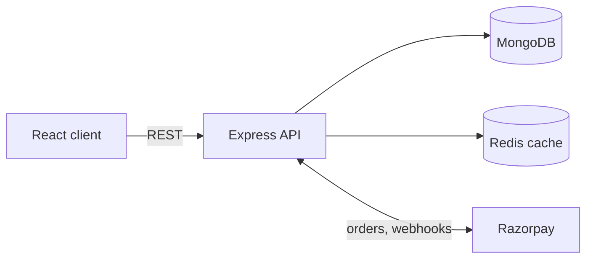
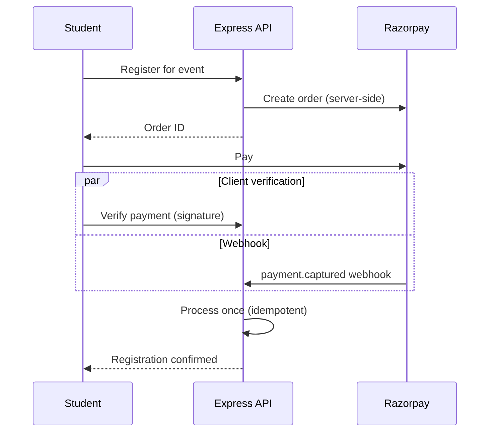

# Fiestura

**A full-stack college event platform where students discover and register for events, pay online, and organizers manage everything from an admin panel.**

[Live demo](https://fiestura.vercel.app) · [Backend code](./backend) · [Frontend code](./frontend)

<!-- Add 2-3 screenshots or a short GIF here. Example:

-->

---

## Why I built this

College events are scattered across WhatsApp groups and posters. Fiestura puts discovery, registration, payment and organizer tools in one place.

I used it as a way to learn the parts of backend work that tutorials skip: what happens when a payment webhook arrives twice, when cached data goes stale, or when a request has bad input.

## What it does

**Students**
- Sign up and log in (JWT)
- Browse and filter events (upcoming, ongoing, past status is computed automatically)
- Register for events, pay through Razorpay, and view their registrations

**Admins**
- Role-protected routes for creating, updating and deleting events
- View users and manage registrations
- Set event capacity [[VERIFY: capacity is enforced at registration time]]

## Tech stack

| Layer | Tools |
|---|---|
| Frontend | React (Vite), Axios, Tailwind CSS, deployed on Vercel |
| Backend | Node.js, Express |
| Database | MongoDB with Mongoose |
| Cache | Redis |
| Auth | JWT, role-based access control |
| Validation | Zod |
| Payments | Razorpay (orders, verification, webhooks) |
| Email | Nodemailer (Gmail SMTP) |
| DevOps | Docker, Docker Compose |

## Architecture



Backend layout:

```
backend/
├── config/        # DB, Redis, Razorpay setup
├── controllers/   # request handling and business logic
├── middleware/    # auth, role checks, error handling
├── models/        # Mongoose schemas
├── routes/        # route definitions
├── utils/         # email and helpers
├── validators/    # Zod schemas
└── index.js
```

## Design decisions

These are the parts I spent the most time on.

### 1. Payments that survive failure

A payment can be confirmed in two ways: the client calls a verify endpoint after checkout, and Razorpay sends a webhook. Either can arrive first, arrive twice, or not arrive at all.



- Orders are created on the server so the amount can't be tampered with by the client.
- Signatures are verified before anything is marked paid. [[VERIFY: webhook signature is verified too]]
- Processing is idempotent: [[DESCRIBE YOUR MECHANISM, e.g. "a payment is only applied if its status is not already 'paid', keyed on the Razorpay payment ID"]]. Whichever of verify or webhook arrives second does nothing.
- Failed payments are recorded and do not create a registration.

### 2. Redis caching

- What is cached: [[e.g. event listings and single event lookups]]
- TTL: [[e.g. 60 seconds]]
- Invalidation: [[e.g. cache keys are cleared when an event is created, updated or deleted, or when a registration changes available capacity]]
- Result: [[X ms → Y ms on GET /events, measured with ... ]]

### 3. Database performance

- Indexes on [[fields]] to support [[queries]]
- Pagination and result limits on list endpoints
- [[N+1 problem I found: where it was, how I found it, and what I changed, e.g. aggregation pipeline instead of looping queries]]

### 4. Validation and errors

- Zod schemas in `validators/` reject bad input before it reaches controllers.
- A central error handler returns consistent JSON errors.

## Running locally

**Prerequisites:** Node.js 18+, Docker, a MongoDB URI, Razorpay test keys.

```bash
git clone https://github.com/akshanshy/fiestura.git
cd fiestura
```

**Backend (with Redis, via Docker Compose)**

```bash
cd backend
cp .env.example .env     # fill in the values below
docker compose up --build
```

**Frontend**

```bash
cd frontend
cp .env.example .env
npm install
npm run dev
```

**Backend environment variables**

```
PORT=5000
MONGO_URI=
JWT_SECRET=
REDIS_URL=
RAZORPAY_KEY_ID=
RAZORPAY_KEY_SECRET=
RAZORPAY_WEBHOOK_SECRET=
EMAIL_USER=
EMAIL_PASS=
```

<!-- Update names above to match your actual .env keys. Never commit real values. -->

## API overview

| Area | Examples |
|---|---|
| Auth | register, login |
| Events | list (paginated, filterable), get, create/update/delete (admin) |
| Registrations | register for event, list my registrations |
| Payments | create order, verify payment, webhook |

<!-- Replace with your exact routes, or link to Swagger/Postman docs. -->

## Known limitations and next steps

I'd rather be upfront about what's missing:

- [ ] Automated tests for the payment and registration flows
- [ ] CI with GitHub Actions
- [ ] API documentation (Swagger or a Postman collection)
- [ ] Rate limiting and security headers
- [ ] [[anything else you know is missing]]

## What I learned

>Full request lifecycle. Building the React UI, calling the API with Axios, and handling auth tokens, loading states and errors on both sides taught me how a request actually travels from click to database and back.

>Payments are about failure, not the happy path. Integrating Razorpay meant handling server-side orders, signature verification, and webhooks that can arrive before, after, or alongside the client’s verify call. Making processing idempotent was the key to never registering or charging a user twice.

>Scaling basics. Pagination, MongoDB indexes and Redis caching (with TTL and invalidation) showed me that performance and correctness pull against each other, especially when cached data goes stale.

>Consistent environments. Moving configuration into environment variables and running the backend and Redis through Docker Compose removed the “works on my machine” problem.
---

Built by [Akshansh](https://github.com/akshanshy). Feedback and suggestions are welcome.
